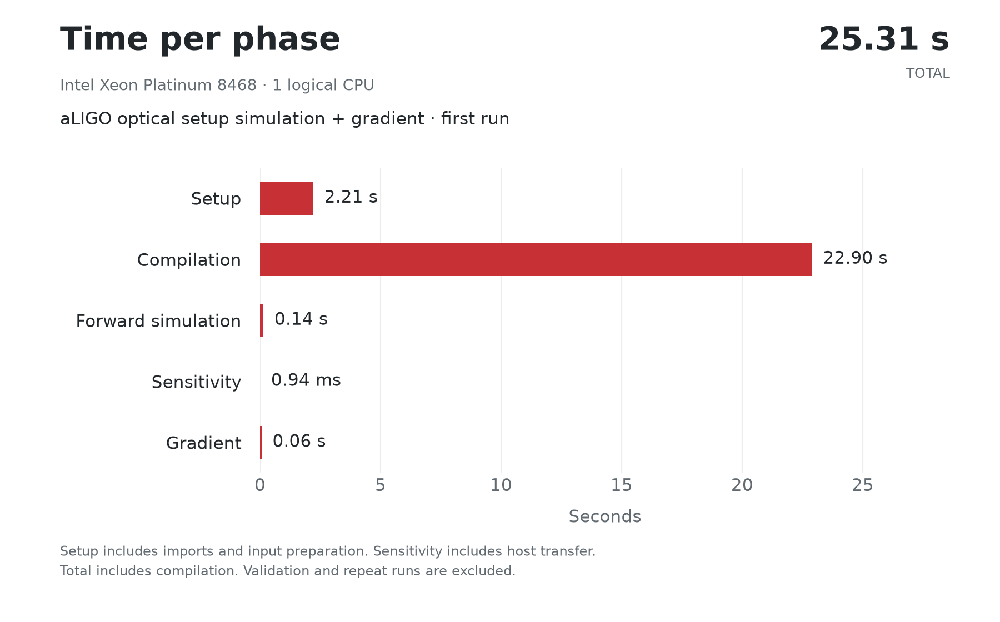

# Faster Physics — START Hack Munich 2026

Make **Differometor** faster for general optical setups while preserving its physical predictions and gradients.

This repository includes the public simulator source, example data, [challenge PDF](challenge.pdf), [judging criteria PDF](judging-criteria.pdf), [editable brief](challenge.docx), a short [start-here example](start_here.py), the [original benchmark](benchmark.py), and a second [aLIGO benchmark](benchmark_aligo.py). No separate simulator checkout or GPU is required.

**Final evaluation uses a different optical setup**, a slight variation of the supplied example. Use this example to develop and benchmark improvements that carry over to other optical setups.

## Our submission

This repository is our entry. The simulator in `differometor/` has been changed for speed; everything below this section is the organizers' original description of the challenge. The submitted code is the tag `v13-one-cpu-dispatch` (`v13`), which is the simulator on `main`. It is `v12`, the version the timings below were made with, plus one setting that removes a freeze on one CPU and does not change the time (0.665 s against 0.664 s for `v12` in ten rounds on the Intel Xeon; CHANGES.md, change 22).

### Result

Official `benchmark.py --cpus 1` on the organizers' processor type (Intel Xeon Platinum 8468, one pinned logical CPU, 32 GiB memory cap), both on the same VM:

| | Original | Ours (`v12`) |
| --- | ---: | ---: |
| **Complete first run** (the scored number) | 41.31 s (one run) | **0.626 s** (median of 10 fresh runs, 0.612 to 0.640 s) |
| Official validation | `PASS` | `PASS` |

That is about 66 times faster. On another VM of the same type the original took 43.14 s and our previous version (`v11`) 0.71 s; within one session `v12` is 1.07 times faster than `v11`, in ten of ten rounds.

### Before and after: reports and plots

| | Report | Plot |
| --- | --- | --- |
| Before: the original, Intel Xeon Platinum 8468, `--cpus 1` (41.31 s) | [json](bench/results/nebius-xeon-8468-200g-linux/original-reproduction/original-1cpu-32g-vm2.json) | [png](bench/results/nebius-xeon-8468-200g-linux/original-reproduction/original-1cpu-32g-vm2.png) |
| After: `v12`, same VM, 10 fresh runs through our harness (0.626 s median) | [session](bench/results/intel-xeon-platinum-8468-197g-linux/sessions/2026-11-22T10-05-52Z_run.json), [check against the original](bench/results/intel-xeon-platinum-8468-197g-linux/validation/f4f5c40@f4f5c40d53d8.json) | [png](bench/results/intel-xeon-platinum-8468-197g-linux/summary.png) |
| After: `v12`, official report, one pinned core of an AMD EPYC 7763 (0.734 s) | [json](bench/results/amd-epyc-7763-64-core-processor-16g-linux/official/v12-kept-assembly.json) | [png](bench/results/amd-epyc-7763-64-core-processor-16g-linux/official/v12-kept-assembly.png) |
| After: `v12`, official aLIGO report, same machine (0.595 s) | [json](bench/results/amd-epyc-7763-64-core-processor-16g-linux/official/v12-kept-assembly-aligo.json) | [png](bench/results/amd-epyc-7763-64-core-processor-16g-linux/official/v12-kept-assembly-aligo.png) |
| After: `v12`, official single-run report on the Intel Xeon Platinum 8468, same VM as the original (0.657 s, `PASS`) | [json](bench/results/intel-xeon-platinum-8468-197g-linux/official/v12-kept-assembly.json), [check against the original](bench/results/intel-xeon-platinum-8468-197g-linux/validation/v12-kept-assembly@f4f5c40d53d8.json) | [png](bench/results/intel-xeon-platinum-8468-197g-linux/official/v12-kept-assembly.png) |
| After: `v13` (the submitted code), official single-run report on the Intel Xeon Platinum 8468 (0.665 s, `PASS`) | [json](bench/results/intel-xeon-platinum-8468-197g-linux/official/v13-one-cpu-dispatch.json), [check against the original](bench/results/intel-xeon-platinum-8468-197g-linux/validation/v13-one-cpu-dispatch@d234ee0a9a8c.json) | [png](bench/results/intel-xeon-platinum-8468-197g-linux/official/v13-one-cpu-dispatch.png) |
| After: `v11`, official report on the Intel Xeon Platinum 8468 (0.667 s) | [json](bench/results/intel-xeon-platinum-8468-197g-linux/official/v11-scipy-stacked-solver.json) | [png](bench/results/intel-xeon-platinum-8468-197g-linux/official/v11-scipy-stacked-solver.png) |
| Before and after on one more machine (AMD EPYC 9334, `v07`: 35.62 s and 0.715 s) | [original](benchmarks/amd-epyc-9334-original.json), [ours](benchmarks/amd-epyc-9334-candidate.json) | [original](benchmarks/amd-epyc-9334-original.png), [ours](benchmarks/amd-epyc-9334-candidate.png) |

The official single-run report of `v12` on the Intel Xeon was made with `python bench/run.py official --versions v12-kept-assembly` (22 November, 10:55 UTC, logical CPU 15, 32 GiB memory cap): first run 0.657 s, repeat median 0.107 s over 10 repeats, `PASS`.

### Our approach in short

1. **Compile less.** In the original, most of a first run is JAX tracing and compiling. We first made the compiled program small (each physics formula compiled once, only non-zero matrix entries built, quick-compile settings), then moved the simulation itself into NumPy behind one JAX call, so almost nothing is left to compile. `simulate` is still a JAX function that works under `jit`, `grad` and `vjp`.
2. **Solve sparse.** The signal matrices are 0.5% filled. They are solved with a sparse LU (SciPy's SuperLU), all frequencies in one factorisation, and one factorisation serves the forward pass and the gradient.
3. **Do the algebra first.** One of three solves per frequency cancels and was dropped; the gradient's solves reuse what the forward pass has; the reverse pass is written out by hand and reuses the matrices the forward pass built.
4. **Derivatives only where needed.** The physics formulas are differentiated only with respect to inputs that depend on a design variable.
5. **Nothing tied to the supplied setup.** Sizes, sparsity patterns and index maps are derived from the setup at hand, and every change was tested on 19 other setups.

What we learned: after the solver, the time is in compilation and imports, not in arithmetic; a faster number means nothing until every output and all gradient entries agree with the original's; and on one core a measurement is only worth as much as its noise floor. About 0.42 s of a first run on that processor is outside our code (`import jax` and the benchmark's own compilations).

### Correctness

- `benchmark.py` and `benchmark_aligo.py` print `PASS`; the distance from the public reference is 5.374e-06 in log sensitivity (limit 1e-5), the same as the original's.
- `bench/validate.py` compares every output and all 193 gradient entries with the arrays the original produced: `PASS` on the Intel Xeon, an AMD EPYC and an Apple M5 (sensitivity within 6e-08 in log).
- `tests/variations.py` compares 19 other setups with the original (other values, frequencies, layouts, readouts, grid sizes, modulation modes): 18 `PASS` and one explained `DEVIATION`, where the original's own rounding is the larger error ([tests/variations/README.md](tests/variations/README.md), CHANGES.md "Correctness checks").
- `tests/test_host.py` compares our NumPy path with our JAX path on 13 cases and checks the gradient against finite differences; `tests/stress.py` adds 24 random layouts from 1 Hz to 10 kHz, gradients requested out of order and from several threads, and memory over 300 evaluations.
- `tests/one_cpu_calls.py` calls the simulator in five different orders on one pinned CPU, including an optimizer loop that never waits for a result; all return. Before change 22 two of them froze.
- The submission was packed as a zip, unpacked on the Intel Xeon and given a new environment from its `requirements.txt`: both benchmarks print `PASS` (0.678 s and 0.507 s), and still do after `pip uninstall klujax` (0.654 s and 0.504 s).
- All frequencies and all design variables are computed, in double precision. Nothing is cached between runs and no work is moved out of the timed region.

### Reproduce and check

```bash
python3.12 -m venv .venv && source .venv/bin/activate
python -m pip install -r requirements.txt && python -m pip install -e .
python benchmark.py --cpus 1 --output benchmark-candidate.json   # the scored run; prints PASS
python benchmark_aligo.py --cpus 1                               # the second benchmark; prints PASS
python bench/validate.py WORKTREE     # every output and all 193 gradient entries against the original's
python tests/variations.py            # 19 other setups against the original
python tests/test_host.py             # our NumPy path against our JAX path
python tests/stress.py                # random layouts, threads, memory
python tests/one_cpu_calls.py         # five ways of calling the simulator on one CPU (Linux)
```

These commands were run from a fresh clone and a fresh environment on 22 November 2026; all pass. The very first run after installing is slower for any version, because the packages are read from disk for the first time (on a Mac we saw 10.7 s once, then 0.3 s); time the second run.

### More

- **What we changed and why:** [CHANGES.md](CHANGES.md), twenty-one changes, each with its measurement and its correctness evidence. Version by version: [bench/VERSIONS.md](bench/VERSIONS.md).
- **Every run we made:** [bench/RUNS.md](bench/RUNS.md).
- **Dependencies:** nothing beyond the organizers' `requirements.txt` is needed on the main path, which solves with SciPy. `klujax==0.5.3` (a JAX wrapper around the sparse solver KLU, pinned in `requirements.txt` and `pyproject.toml`) is used only by the fallback for setups with linking functions; with klujax uninstalled both benchmarks still print `PASS`.
- **The code before the SciPy solver** is kept on the branch `legacy-klujax`.
- **On Linux the package changes two process-wide settings:** the C library keeps freed memory for reuse (change 21; skipped if `MALLOC_*` variables or `GLIBC_TUNABLES` are set), and with exactly one CPU JAX finishes each call before it returns (change 22; skipped if `JAX_CPU_ENABLE_ASYNC_DISPATCH` is set).
- **A caveat on timing:** on a busy shared Linux host an earlier version took between 0.74 and 2.8 s in one session. What we found out about it, and a setting that may help on such a host (`NUMPY_MADVISE_HUGEPAGE=0`), is in CHANGES.md ("The same on one pinned Linux core" and "Withdrawn").

## Start here

Use **Python 3.12 on Linux or WSL2**, with **32 GB RAM recommended**. Clone the repository:

```bash
git clone https://github.com/feyerlabs/start-hack-munich-2026.git
cd start-hack-munich-2026
```

Alternatively, [download the ZIP](https://github.com/feyerlabs/start-hack-munich-2026/archive/refs/heads/main.zip), unpack it and open a terminal in its root folder. Then install and run:

```bash
python3.12 -m venv .venv
source .venv/bin/activate
python -m pip install --upgrade pip
python -m pip install -r requirements.txt
python -m pip install -e .
python start_here.py
```

[`start_here.py`](start_here.py) walks through one complete simulation and gradient calculation in five steps. It prints setup time, compilation time, and combined simulation/sensitivity/gradient runtime. It runs once using the CPUs available to the process.

For reproducible measurements, numerical checks and the five-bar plot, use the full benchmark:

```bash
python benchmark.py --cpus 1 --output benchmark-baseline.json
```

`--cpus 1` pins the process to one logical CPU on Linux/WSL. With the organizers' original code the full benchmark takes roughly 5 minutes for ten repetitions and validation (with the code in this repository: a few seconds, and well under 1 GB of memory), prints `PASS`, and writes `benchmark-baseline.json` and `benchmark-baseline.png`. Use `--repeats 3` for a shorter run or `--save-arrays baseline.npz` to save outputs. The measured peak memory was about 14.4 GiB.

## If setup fails

- **Python missing:** install Python 3.12 first. On Debian/Ubuntu, the matching `python3.12-venv` package may also be needed for virtual environments.
- **Windows:** use WSL2 and make enough RAM available to it. The single-CPU command uses Linux process affinity.
- **Process killed / out of memory:** close other memory-heavy applications or use a machine with more available RAM. Reducing `--repeats` shortens the run but does not reduce peak memory.
- **Numerical check fails:** restore the unchanged public fixtures and run the unmodified baseline with the pinned dependencies before investigating your changes.

## Development benchmark

The supplied example uses one complete saved 3×3 optical setup, all **101 frequencies from 800–3000 Hz**, and gradients for **193 physical design variables**. Every evaluation computes carrier fields, signal, quantum noise, detector sensitivity, powers and the gradient of mean log sensitivity relative to the public reference.

In `benchmark.py`, the complete first-run total includes input preparation, all compilation, the forward simulation, sensitivity and gradients. Imports, CPU initialization and result transfer are included. Validation and benchmark logging/report/plot generation are excluded. There is no optimization loop.

The benchmark’s five bars group the detailed measurements without dropping work. Setup includes imports, initialization and loading/building inputs. Compilation combines lowering and compilation for all stages. Sensitivity includes readout and host transfer. The raw JSON retains every stage and all warm repetitions.

## Second benchmark: aLIGO

Try another optical setup to check whether your improvements generalize:

```bash
python benchmark_aligo.py --cpus 1 --output benchmark-aligo.json
```

This uses the public **simplified Advanced LIGO (aLIGO)** setup, including mirror mechanics and squeezed light, with all **101 reference frequencies from 20–5000 Hz**. It computes the full simulation, sensitivity, powers and gradients for **29 design variables**: reflectivity, tuning, squeezing strength/angle, laser power, mass and independent optical lengths.

The script shares the original benchmark's five-phase timing harness. Setup, all compilation, forward simulation, sensitivity and gradients count toward the total; validation and plotting are excluded. It writes `benchmark-aligo.json` and `benchmark-aligo.png`, and accepts the same `--repeats`, `--save-arrays` and `--plot` options. A successful run prints `PASS` after checking the public sensitivity reference, finite outputs and a gradient sanity check. The aLIGO reference uses its upstream log-sensitivity tolerance of `1e-6`.

## Improve and compare

1. Run the unmodified baseline in a fresh Python process.
2. Use the phase plot to find a bottleneck, then edit `differometor/`.
3. Run `python benchmark.py --cpus 1 --output benchmark-candidate.json`.
4. Compare complete time, including compilation, on matching hardware, CPU affinity and software. Report median warm runtime separately and repeat measurements to assess variability.

For local comparisons, keep the supplied setup, every frequency, double precision, physical outputs and gradients. Optimize the simulator so the speedup carries over to other optical setups. The full benchmark runs the quick correctness checks described below. Precomputed answers and omitted calculations do not count.

Submit your code, before/after JSON reports and plots, and reproduction commands. A short note on your approach and correctness checks is welcome.

## Judging and prizes

Download the standalone [Judging Criteria PDF](judging-criteria.pdf), including timing rules and correctness checks.

- **First prize:** Lowest complete evaluation time among correct submissions.
- **Second prize:** Second-lowest complete evaluation time among correct submissions.
- **Special prize:** The most surprising solution, chosen by the Feyer team.

The speed prizes use the **complete first-run total on the final optical setup**, with matching hardware and CPU limits. Include imports, initialization, input preparation, all compilation, forward simulation, sensitivity, gradients and result transfer. Validation and benchmark reporting remain outside the timer; warm runtime is reported separately.

AI coding tools are welcome. A high-level explanation of your approach, why it helps and what you learned is encouraged and helps the Feyer team understand your work.

## Correctness: quick checks

A correct submission evaluates the complete input setup, all requested frequencies and design variables, in double precision. It preserves physical results and gradients on both the development example and the final setup.

For the supplied development benchmark (**101 frequencies**, **193 design variables**), the checks require:

- **Correct sensitivities:** positive sensitivity at every frequency, matching the public reference with `abs(log(sensitivity) - log(reference)) <= 1e-5` (natural logarithm; about 0.001% relative difference).
- **Finite results:** carrier, signal, noise, sensitivity, powers, loss and all 193 gradient values contain no NaN or infinity; the gradient is not identically zero.
- **Consistent gradients:** gradients should pass the supplied sanity check.

Run a shorter check with:

```bash
python benchmark.py --cpus 1 --repeats 3 --output benchmark-check.json
```

A successful run prints `PASS`. These quick checks cover the supplied workload and run outside the scored time. For larger numerical changes, comparing saved arrays or trying another public setup is helpful.

## CPU baseline

Tested on **16 November 2026** on an **Intel Xeon Platinum 8468**, pinned to **one logical CPU** with **32 GB RAM** allocated. CPU affinity and numerical-library thread limits are recorded in the [raw report](benchmarks/cpu-baseline.json). No GPU was used.


| Measurement | Seconds |
| --- | ---: |
| Complete first-run total, including compilation | **44.204** |
| Total tracing/lowering and compilation | 22.918 |
| Median warm evaluation, ten repetitions | **17.679** |
| Warm minimum / maximum | 17.118 / 18.282 |

All 101 frequencies and 193 gradients were evaluated. The public sensitivity test and two-step numerical gradient check passed. This was measured on a shared worker, so record your own baseline. The full benchmark adds archive support and output-path checks to the measured version; its numerical workload is unchanged. The short starter compiles simulation and differentiation together, so its timings are not directly comparable to this staged benchmark.

### aLIGO — second setup

Tested on **21 November 2026** on an **Intel Xeon Platinum 8468**, pinned to **one logical CPU** with 32 GB RAM allocated. The run covered all **101 frequencies and 29 gradients**; reference-sensitivity and gradient checks passed. See the [raw aLIGO report](benchmarks/aligo-cpu-baseline.json).



| Measurement | Seconds |
| --- | ---: |
| Complete first-run total, including compilation | **25.309** |
| Total tracing/lowering and compilation | 22.897 |
| Median warm evaluation, ten repetitions | **0.124** |
| Warm minimum / maximum | 0.122 / 0.162 |

These are different optical workloads; use each setup's own baseline when measuring a speedup.

Replot either saved report without running the simulation:

```bash
python plot_timings.py benchmark-baseline.json --output benchmark-baseline.png
python plot_timings.py benchmark-aligo.json --output benchmark-aligo.png
```

## Public source and license

The simulator started from the public [Artificial Scientist Lab Differometor](https://github.com/artificial-scientist-lab/Differometor) at commit `b0dc7c79e7c72a1b010174f6bdcad01efa51d6ff`. In this repository `differometor/` has since been modified for speed; [CHANGES.md](CHANGES.md) lists every change. This repository adds the Feyer hackathon brief and benchmarking tools. The full upstream instructions remain in [README.upstream.md](README.upstream.md); the upstream [MIT license](LICENSE) is retained.

[UPSTREAM.json](UPSTREAM.json) records the original simulator and fixture hashes.
