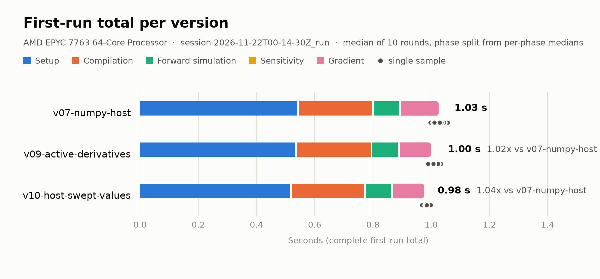

# Benchmark summary: amd-epyc-7763-64-core-processor-16g-linux

- Machine: AMD EPYC 7763 64-Core Processor, 16 GiB RAM, Linux-6.8.0-1070-azure-x86_64-with-glibc2.39
- CPU limit: pinned to logical CPU 3 with the official `--cpus 1`
- Noise floor: not measured yet. Run `python bench/run.py aa`.
- Sessions on record: 1

## Latest session: `2026-11-22T00-14-30Z_run`

10 rounds, shuffled order per round, one fresh process per sample.

| Version                | n     | median s | min s | spread | vs v07-numpy-host  | vs parent          | Setup | Compile | Forward | Sens. | Grad. | peak mem | cpu/wall | valid | flags                                   |
| ---------------------- | ----- | -------- | ----- | ------ | ------------------ | ------------------ | ----- | ------- | ------- | ----- | ----- | -------- | -------- | ----- | --------------------------------------- |
| v07-numpy-host         | 10/10 | 1.03     | 1.00  | 5.7%   | -                  | -                  | 0.54  | 0.26    | 0.09    | 0.00  | 0.13  | 0.36 GiB | 1.01     | -     | slow-machine 1/10                       |
| v09-active-derivatives | 10/10 | 1.00     | 0.99  | 4.7%   | 1.02x (0.99-1.05)~ | 1.02x (0.99-1.05)~ | 0.53  | 0.26    | 0.09    | 0.00  | 0.11  | 0.35 GiB | 1.01     | -     | unofficial-benchmark                    |
| v10-host-swept-values  | 10/10 | 0.98     | 0.96  | 3.5%   | 1.04x (1.03-1.08)  | 1.02x (0.99-1.06)~ | 0.52  | 0.26    | 0.09    | 0.00  | 0.11  | 0.36 GiB | 1.01     | -     | slow-machine 3/10, unofficial-benchmark |

## Speed-up over the session's reference, across sessions

One column per session. A version whose factor stays put from column to column is a trustworthy result.
Against the stored baseline every session divides into the same number, so those factors are directly comparable.

| Version                | 11-22T00-14 run |
| ---------------------- | --------------- |
| v07-numpy-host         | ref             |
| v09-active-derivatives | 1.02x           |
| v10-host-swept-values  | 1.04x           |

## Reading the tables

- `median s` / `min s`: complete first-run total printed by the version's own benchmark.py (the scored number).
- `vs X`: speed-up over X, median of the per-round ratios, with the lowest and highest round in brackets.
  `~` = not distinguishable from noise. `*` = X ran under memory pressure, so the factor is overstated.
  `(stored)` = X is the baseline, which ran once and is not rerun: every round is divided into that one
  stored total, so the bracket shows only this version's own scatter.
- `spread`: (max - min) / median of the totals. `cpu/wall`: CPU-seconds per wall-second, about 1.00 means one core.
- Flags (count / samples): `memory` = swapping or heavy compression during the run, `slow-machine` = the canary
  ran more than 5 % slower than the session's best, `multi-core` = more than one core was used,
  `failed` / `timeout` = no result, `unofficial-benchmark` = benchmark.py differs from the baseline's.
