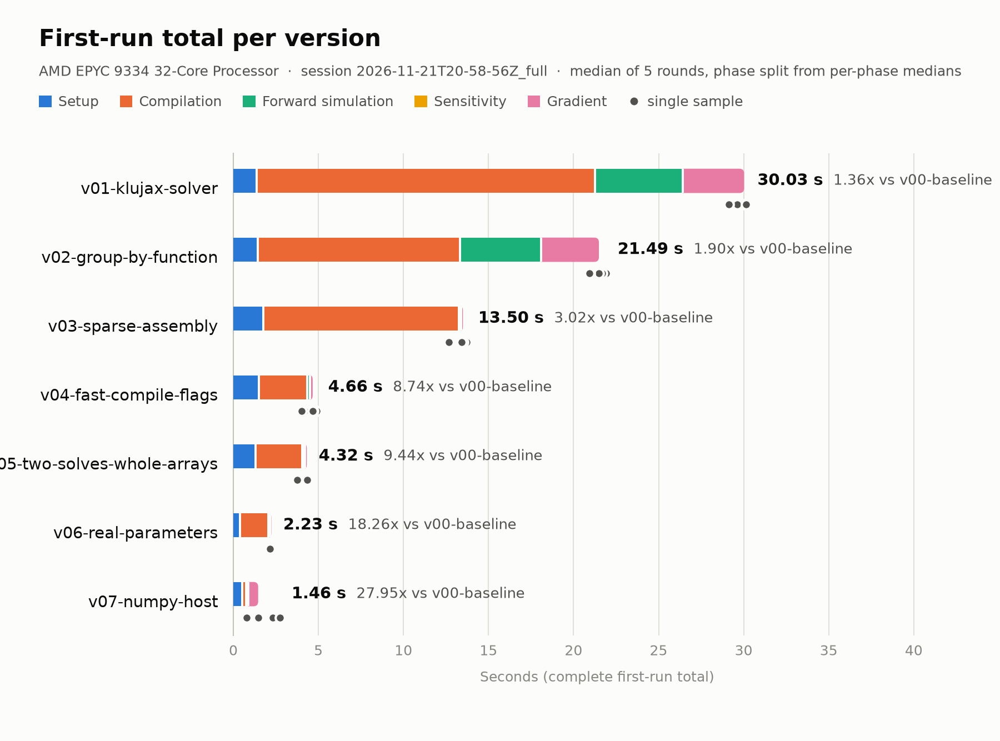

# Benchmark summary: amd-epyc-9334-32-core-processor-504g-linux

- Machine: AMD EPYC 9334 32-Core Processor, 504 GiB RAM, Linux-6.8.0-79-generic-x86_64-with-glibc2.35
- CPU limit: pinned to logical CPU 127 with the official `--cpus 1`
- Noise floor: +/- 236.0 % (A/A session `2026-11-21T21-12-08Z_aa`). Smaller differences are not speed-ups.
- Sessions on record: 2

## Latest full session: `2026-11-21T20-58-56Z_full`

5 rounds, shuffled order per round, one fresh process per sample.

| Version                     | n   | median s | min s | spread | vs v00-baseline (stored) | vs parent          | Setup | Compile | Forward | Sens. | Grad. | peak mem | cpu/wall | valid | flags            |
| --------------------------- | --- | -------- | ----- | ------ | ------------------------ | ------------------ | ----- | ------- | ------- | ----- | ----- | -------- | -------- | ----- | ---------------- |
| v01-klujax-solver           | 5/5 | 30.03    | 29.13 | 3.3%   | 1.36x (1.35-1.40)~       | -                  | 1.36  | 19.58   | 5.08    | 0.00  | 3.55  | 9.36 GiB | 1.03     | PASS  | -                |
| v02-group-by-function       | 5/5 | 21.49    | 20.94 | 4.5%   | 1.90x (1.86-1.95)~       | 1.39x (1.37-1.44)~ | 1.43  | 11.81   | 4.73    | 0.00  | 3.36  | 8.69 GiB | 1.04     | PASS  | slow-machine 1/5 |
| v03-sparse-assembly         | 5/5 | 13.50    | 12.68 | 7.6%   | 3.02x (2.97-3.22)~       | 1.60x (1.56-1.65)~ | 1.75  | 11.41   | 0.13    | 0.00  | 0.11  | 1.03 GiB | 1.01     | PASS  | slow-machine 2/5 |
| v04-fast-compile-flags      | 5/5 | 4.66     | 4.03  | 18.6%  | 8.74x (8.34-10.13)       | 2.88x (2.80-3.22)~ | 1.50  | 2.85    | 0.17    | 0.00  | 0.15  | 0.56 GiB | 1.01     | PASS  | slow-machine 1/5 |
| v05-two-solves-whole-arrays | 5/5 | 4.32     | 3.74  | 13.8%  | 9.44x (9.40-10.89)       | 1.09x (0.93-1.31)~ | 1.30  | 2.77    | 0.15    | 0.00  | 0.10  | 0.51 GiB | 1.01     | PASS  | -                |
| v06-real-parameters         | 5/5 | 2.23     | 2.15  | 4.8%   | 18.26x (18.09-18.99)     | 1.92x (1.66-2.02)~ | 0.40  | 1.65    | 0.08    | 0.00  | 0.10  | 0.35 GiB | 1.01     | PASS  | -                |
| v07-numpy-host              | 5/5 | 1.46     | 0.74  | 137.5% | 27.95x (14.86-55.26)     | 1.47x (0.79-3.05)~ | 0.40  | 0.18    | 0.08    | 0.00  | 0.45  | 0.38 GiB | 1.01     | PASS  | -                |

Stored baseline: v00-baseline took 40.79 s in its single run on 2026-11-21. It is not rerun: each factor against it is this number divided by a new sample.

## Latest session: `2026-11-21T21-12-08Z_aa`

5 rounds, shuffled order per round, one fresh process per sample.

| Version          | n   | median s | min s | spread | vs v07-numpy-host#A | vs parent | Setup | Compile | Forward | Sens. | Grad. | peak mem | cpu/wall | valid | flags |
| ---------------- | --- | -------- | ----- | ------ | ------------------- | --------- | ----- | ------- | ------- | ----- | ----- | -------- | -------- | ----- | ----- |
| v07-numpy-host#A | 5/5 | 2.47     | 2.35  | 16.8%  | -                   | -         | 1.20  | 0.18    | 0.57    | 0.00  | 0.49  | 0.38 GiB | 1.01     | PASS  | -     |
| v07-numpy-host#B | 5/5 | 1.01     | 0.73  | 144.5% | 2.64x (1.26-3.36)~  | -         | 0.38  | 0.17    | 0.08    | 0.00  | 0.38  | 0.38 GiB | 1.02     | PASS  | -     |

## Speed-up over the session's reference, across sessions

One column per session. A version whose factor stays put from column to column is a trustworthy result.
Against the stored baseline every session divides into the same number, so those factors are directly comparable.

| Version                     | 11-21T20-58 full |
| --------------------------- | ---------------- |
| v01-klujax-solver           | 1.36x            |
| v02-group-by-function       | 1.90x            |
| v03-sparse-assembly         | 3.02x            |
| v04-fast-compile-flags      | 8.74x            |
| v05-two-solves-whole-arrays | 9.44x            |
| v06-real-parameters         | 18.26x           |
| v07-numpy-host              | 27.95x           |

## Reading the tables

- `median s` / `min s`: complete first-run total printed by the version's own benchmark.py (the scored number).
- `vs X`: speed-up over X, median of the per-round ratios, with the lowest and highest round in brackets.
  `~` = not distinguishable from noise. `*` = X ran under memory pressure, so the factor is overstated.
  `(stored)` = X is the baseline, which ran once and is not rerun: every round is divided into that one
  stored total, so the bracket shows only this version's own scatter.
- `spread`: (max - min) / median of the totals. `cpu/wall`: CPU-seconds per wall-second, about 1.00 means one core.
- Flags (count / samples): `memory` = swapping or heavy compression during the run, `slow-machine` = the canary
  ran more than 5 % slower than the session's best, `multi-core` = more than one core was used,
  `failed` / `timeout` = no result, `unofficial-benchmark` = benchmark.py differs from the baseline's.
