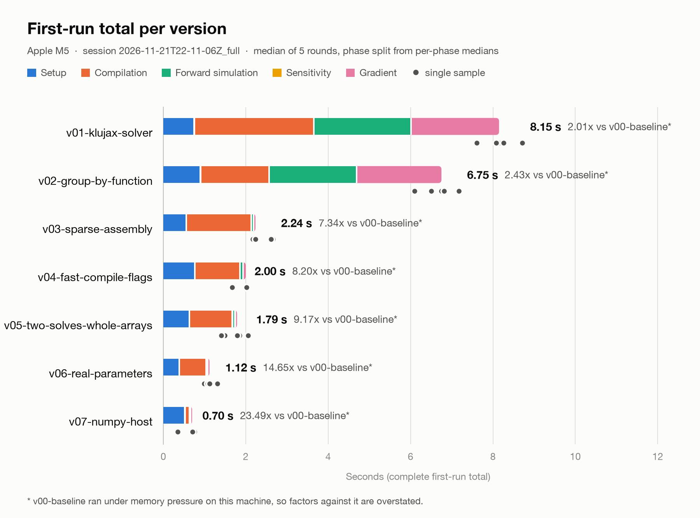

# Benchmark summary: apple-m5-16g-darwin

- Machine: Apple M5, 16 GiB RAM, macOS-26.6-arm64-arm-64bit
- CPU limit: thread limits `MKL_NUM_THREADS=1`, `NPROC=1`, `NUMEXPR_NUM_THREADS=1`, `OMP_NUM_THREADS=1`, `OPENBLAS_NUM_THREADS=1`, `VECLIB_MAXIMUM_THREADS=1`
- Noise floor: +/- 16.2 % (A/A session `2026-11-21T20-38-57Z_aa`). Smaller differences are not speed-ups.
- Sessions on record: 3

## Latest full session: `2026-11-21T22-11-06Z_full`

5 rounds, shuffled order per round, one fresh process per sample.

| Version                     | n   | median s | min s | spread | vs v00-baseline (stored) | vs parent           | Setup | Compile | Forward | Sens. | Grad. | peak mem | cpu/wall | valid | flags                        |
| --------------------------- | --- | -------- | ----- | ------ | ------------------------ | ------------------- | ----- | ------- | ------- | ----- | ----- | -------- | -------- | ----- | ---------------------------- |
| v01-klujax-solver           | 5/5 | 8.15     | 7.61  | 13.5%  | 2.01x (1.89-2.16)*       | -                   | 0.75  | 2.89    | 2.35    | 0.00  | 2.12  | 8.55 GiB | 1.85     | PASS  | memory 5/5, multi-core 5/5   |
| v02-group-by-function       | 5/5 | 6.75     | 6.09  | 16.0%  | 2.43x (2.29-2.69)*       | 1.21x (1.19-1.27)*  | 0.90  | 1.66    | 2.11    | 0.00  | 2.05  | 9.04 GiB | 1.59     | PASS  | memory 5/5, multi-core 5/5   |
| v03-sparse-assembly         | 5/5 | 2.24     | 2.17  | 21.9%  | 7.34x (6.17-7.56)*       | 2.74x (2.45-3.14)*  | 0.57  | 1.59    | 0.06    | 0.00  | 0.05  | 0.49 GiB | 3.20     | PASS  | memory 4/5, multi-core 5/5   |
| v04-fast-compile-flags      | 5/5 | 2.00     | 1.67  | 17.5%  | 8.20x (8.13-9.83)*       | 1.30x (1.10-1.33)*  | 0.76  | 1.09    | 0.07    | 0.00  | 0.07  | 0.46 GiB | 0.99     | PASS  | memory 4/5, slow-machine 1/5 |
| v05-two-solves-whole-arrays | 5/5 | 1.79     | 1.41  | 36.4%  | 9.17x (7.98-11.67)*      | 1.12x (0.97-1.42)~* | 0.63  | 1.05    | 0.07    | 0.00  | 0.05  | 0.38 GiB | 1.01     | PASS  | memory 3/5, multi-core 1/5   |
| v06-real-parameters         | 5/5 | 1.12     | 0.99  | 28.2%  | 14.65x (12.55-16.54)*    | 1.37x (1.10-1.91)*  | 0.39  | 0.66    | 0.04    | 0.00  | 0.04  | 0.25 GiB | 1.02     | PASS  | memory 3/5, slow-machine 1/5 |
| v07-numpy-host              | 5/5 | 0.70     | 0.34  | 59.7%  | 23.49x (21.76-48.72)*    | 1.85x (1.32-3.69)*  | 0.52  | 0.11    | 0.03    | 0.00  | 0.04  | 0.22 GiB | 0.70     | PASS  | memory 2/5                   |

Stored baseline: v00-baseline took 16.41 s in its single run on 2026-11-21, under memory pressure. It is not rerun: each factor against it is this number divided by a new sample.

## Speed-up over the session's reference, across sessions

One column per session. A version whose factor stays put from column to column is a trustworthy result.
Against the stored baseline every session divides into the same number, so those factors are directly comparable.

| Version                     | 11-21T20-21 full | 11-21T22-11 full |
| --------------------------- | ---------------- | ---------------- |
| v01-klujax-solver           | 1.90x*           | 2.01x*           |
| v02-group-by-function       | 2.39x*           | 2.43x*           |
| v03-sparse-assembly         | 6.12x*           | 7.34x*           |
| v04-fast-compile-flags      | 9.74x*           | 8.20x*           |
| v05-two-solves-whole-arrays | 9.15x*           | 9.17x*           |
| v06-real-parameters         | 12.93x*          | 14.65x*          |
| v07-numpy-host              | 33.11x*          | 23.49x*          |

## Reading the tables

- `median s` / `min s`: complete first-run total printed by the version's own benchmark.py (the scored number).
- `vs X`: speed-up over X, median of the per-round ratios, with the lowest and highest round in brackets.
  `~` = not distinguishable from noise. `*` = X ran under memory pressure, so the factor is overstated.
  `(stored)` = X is the baseline, which ran once and is not rerun: every round is divided into that one
  stored total, so the bracket shows only this version's own scatter.
- `spread`: (max - min) / median of the totals. `cpu/wall`: CPU-seconds per wall-second, about 1.00 means one core.
- Flags (count / samples): `memory` = swapping or heavy compression during the run, `slow-machine` = the canary
  ran more than 5 % slower than the session's best, `multi-core` = more than one core was used,
  `failed` / `timeout` = no result, `unofficial-benchmark` = benchmark.py differs from the baseline's.
