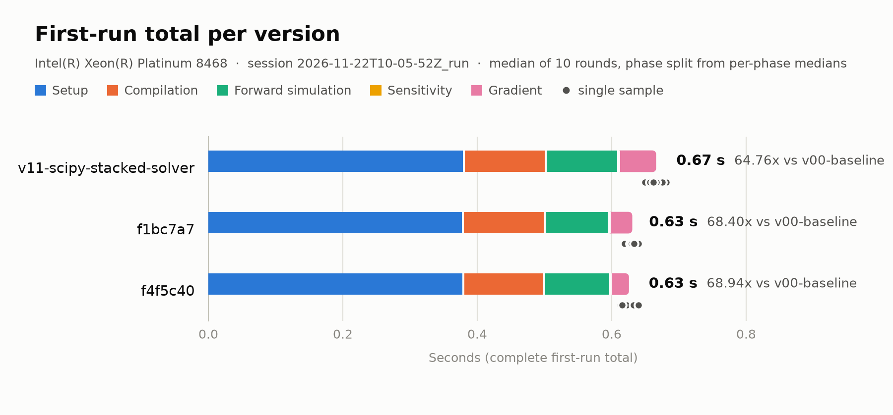

# Benchmark summary: intel-xeon-platinum-8468-197g-linux

- Machine: Intel(R) Xeon(R) Platinum 8468, 197 GiB RAM, Linux-6.11.0-1016-nvidia-x86_64-with-glibc2.39
- CPU limit: pinned to logical CPU 15 with the official `--cpus 1`
- Noise floor: +/- 2.4 % (A/A session `2026-11-22T09-54-18Z_aa`). Smaller differences are not speed-ups.
- Sessions on record: 6

## Latest session: `2026-11-22T10-05-52Z_run`

10 rounds, shuffled order per round, one fresh process per sample.

| Version                  | n     | median s | min s | spread | vs v00-baseline (stored) | vs parent | Setup | Compile | Forward | Sens. | Grad. | peak mem | cpu/wall | valid | flags                                   |
| ------------------------ | ----- | -------- | ----- | ------ | ------------------------ | --------- | ----- | ------- | ------- | ----- | ----- | -------- | -------- | ----- | --------------------------------------- |
| v11-scipy-stacked-solver | 10/10 | 0.67     | 0.65  | 4.7%   | 64.76x (63.35-66.41)     | -         | 0.38  | 0.12    | 0.11    | 0.00  | 0.06  | 0.32 GiB | 1.01     | PASS  | slow-machine 2/10, unofficial-benchmark |
| f1bc7a7                  | 10/10 | 0.63     | 0.62  | 3.3%   | 68.40x (67.38-69.63)     | -         | 0.38  | 0.12    | 0.10    | 0.00  | 0.03  | 0.30 GiB | 1.01     | PASS  | unofficial-benchmark                    |
| f4f5c40                  | 10/10 | 0.63     | 0.61  | 4.4%   | 68.94x (67.42-70.43)     | -         | 0.38  | 0.12    | 0.10    | 0.00  | 0.03  | 0.30 GiB | 1.01     | -     | unofficial-benchmark                    |

Stored baseline: v00-baseline took 43.14 s in its single run on 2026-11-21. It is not rerun: each factor against it is this number divided by a new sample.

## Speed-up over the session's reference, across sessions

One column per session. A version whose factor stays put from column to column is a trustworthy result.
Against the stored baseline every session divides into the same number, so those factors are directly comparable.

| Version                     | 11-21T22-53 run | 11-22T00-08 run | 11-22T00-14 run | 11-22T09-50 run | 11-22T10-05 run |
| --------------------------- | --------------- | --------------- | --------------- | --------------- | --------------- |
| v01-klujax-solver           | 1.29x           |                 |                 |                 |                 |
| v02-group-by-function       | 1.82x           |                 |                 |                 |                 |
| v03-sparse-assembly         | 2.75x           |                 |                 |                 |                 |
| v04-fast-compile-flags      | 8.35x           |                 |                 |                 |                 |
| v05-two-solves-whole-arrays | 9.36x           |                 |                 |                 |                 |
| v06-real-parameters         | 15.55x          |                 |                 |                 |                 |
| v07-numpy-host              | 48.10x          | 50.47x          | 49.21x          | 51.71x          |                 |
| v08-no-large-pages          | 47.30x          |                 |                 |                 |                 |
| no-klujax-scipy             |                 | 64.05x          | 61.17x          |                 |                 |
| v10-host-swept-values       |                 |                 | 51.32x          | 53.13x          |                 |
| v11-scipy-stacked-solver    |                 |                 |                 | 64.25x          | 64.76x          |
| f1bc7a7                     |                 |                 |                 | 67.54x          | 68.40x          |
| f4f5c40                     |                 |                 |                 |                 | 68.94x          |

## Reading the tables

- `median s` / `min s`: complete first-run total printed by the version's own benchmark.py (the scored number).
- `vs X`: speed-up over X, median of the per-round ratios, with the lowest and highest round in brackets.
  `~` = not distinguishable from noise. `*` = X ran under memory pressure, so the factor is overstated.
  `(stored)` = X is the baseline, which ran once and is not rerun: every round is divided into that one
  stored total, so the bracket shows only this version's own scatter.
- `spread`: (max - min) / median of the totals. `cpu/wall`: CPU-seconds per wall-second, about 1.00 means one core.
- Flags (count / samples): `memory` = swapping or heavy compression during the run, `slow-machine` = the canary
  ran more than 5 % slower than the session's best, `multi-core` = more than one core was used,
  `failed` / `timeout` = no result, `unofficial-benchmark` = benchmark.py differs from the baseline's.
